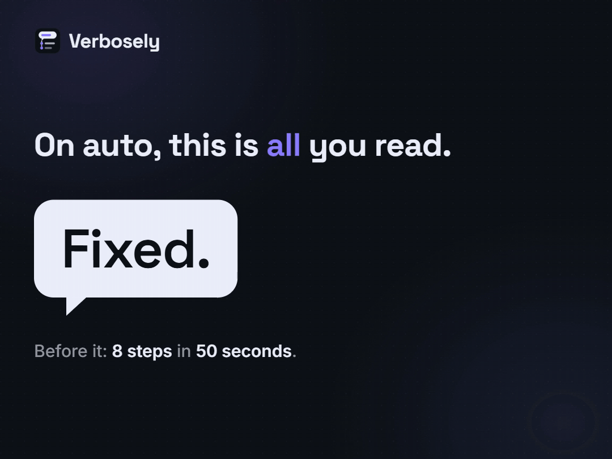
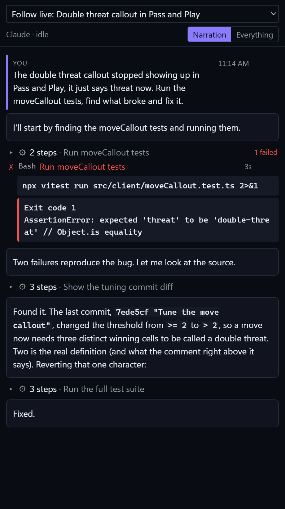
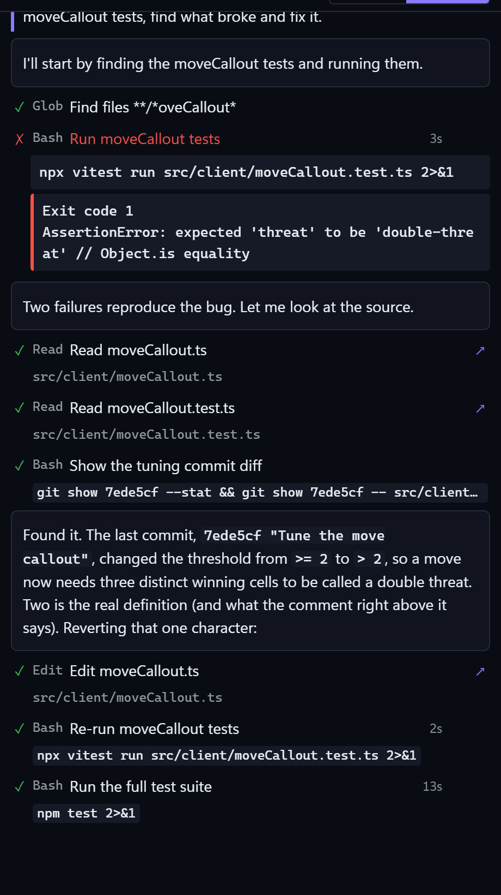
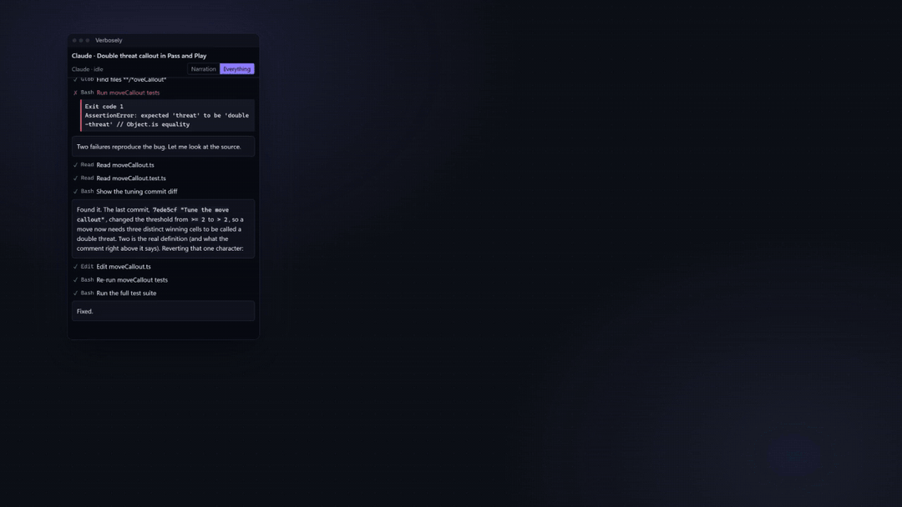
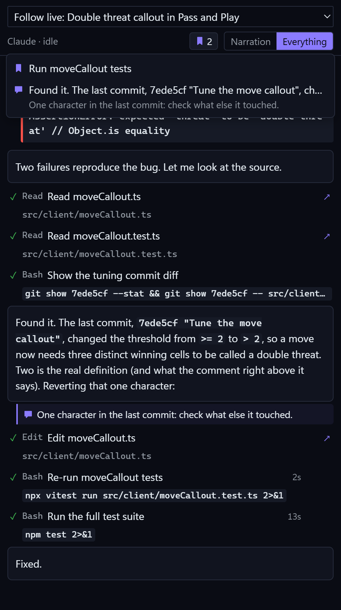

# Verbosely

**Verbose mode for your coding agent.** See what Claude Code and Codex do while they work, not just their final answer.



▶ **[Watch the trailer](https://taredigital.com/verbosely/#trailer)** (46 seconds)

On auto, an agent can work for a minute and hand you one line: "Fixed." The eight steps before it, the test that failed, the commit it found, scroll past in a terminal or fold away in a chat panel. Verbosely keeps that middle layer in a calm, readable feed beside your code, live, while the agent works.

## Get started

1. Install Verbosely.
2. Open your project folder in VS Code.
3. Work with Claude Code or Codex in that folder, the way you already do.
4. Click the **Verbosely** icon in the activity bar.

The feed finds the session that is working and follows it. There is nothing to set up: no account, no API key, no hooks, no extra tokens. Verbosely reads the session logs the agents already write on your computer, so it works for earlier sessions too.

## Read along as it works



The **Narration** view shows what the agent says, in order. The steps between two messages fold into one line, like "3 steps · Show the tuning commit diff", so you follow the story of the work and open the detail only when you want it.

**When a step fails, it stays open, in red**, with the error the agent got. The status bar counts the failed steps since your last message. Click the count and the feed scrolls to the step and outlines it; with several, you pick one from a list.

## See every step, and what actually ran



Switch to **Everything** for every tool call. Each row shows the agent's description of the step and, under it, the command it really ran or the file it touched, with how long it took. Click a row for its output.

That second line matters. A step's headline is the agent's own words, and an agent that has been misled, for example by instructions planted in a web page it read, could describe `curl … | sh` as "Run the tests". So Verbosely also flags steps by what ran:

- a downloaded script run in a shell
- a file uploaded
- a recursive delete, a force push, or discarded changes
- credentials touched, such as `.env` or `~/.ssh`
- settings for the agent, git or the editor changed
- a write outside the workspace
- hidden characters in a command (they are shown as `⟨U+202E⟩`, not hidden)

Flags never block anything. They make sure you notice, and a flagged step stays visible when the Narration view folds its group.

## Keep it in view



Click the pin in the feed's title bar (or run **Verbosely: Pop Out Feed**) and the feed moves into its own small window that floats above your other apps (VS Code 1.100 or later). Handy while you test in an emulator, a browser or a game.

**Open Feed in Browser** shows the same feed in Chrome or Edge, and **Float** puts it in a picture-in-picture window that stays visible even with VS Code minimised. The browser view can only watch.

## Mark what matters



Hover any row to bookmark it or write a note under it. The bookmark button in the header lists them, so you can jump back. Notes are for you: they stay on this computer, for this workspace, and are never written into the agent's logs or sent to the agent.

When you are done, **Export Session as Markdown** gives you a readable record of the session, with your bookmarks, notes and step times. Things that look like secrets (API keys, tokens, private keys) are replaced with `[redacted]`.

## Also in the feed

- **Subagents.** When Claude Code hands work to a subagent, its steps appear in a box under the step that started it.
- **Past sessions.** The session picker lists earlier sessions in this folder, from both agents. Pick one to read it; **Follow Live Session** goes back to following.
- **Times.** Prompts and messages show the time, and "working" shows how long the turn has run, such as `working · 5m 32s`. Turn them off with `verbosely.timestamps`.
- **Your theme.** It follows VS Code's colours and fonts, light, dark or high contrast, works from the keyboard, and turns its small animations off when you ask VS Code or your system to reduce motion.

## Commands

| Command                               | What it does                                        |
| ------------------------------------- | --------------------------------------------------- |
| Verbosely: Pop Out Feed               | The feed in its own window, above other apps        |
| Verbosely: Open Feed in Browser       | The feed in Chrome or Edge, with picture-in-picture |
| Verbosely: Follow Live Session        | Go back to following the session that is working    |
| Verbosely: Show Failed Steps          | Jump to what failed since your last message         |
| Verbosely: Export Session as Markdown | A record of the session, with bookmarks and notes   |

There are no default keyboard shortcuts, so nothing clashes with yours. Set your own in **Keyboard Shortcuts**.

## Privacy and security

- **What it reads:** the agents' own session logs, `~/.claude/projects/` and `~/.claude/sessions/` for Claude Code, `~/.codex/sessions/` and `~/.codex/session_index.jsonl` for Codex. Only sessions that ran in the open folder are shown. It never writes to these files.
- **What it stores:** your bookmarks and notes, in VS Code's storage for this workspace, on this computer.
- **No internet:** the extension makes no network requests. (The agents themselves send your prompts to their providers; Verbosely only reads what they log.)
- **The browser view** runs a small local server only while you use it. It listens on `127.0.0.1` only and checks the `Host` header. The link VS Code opens works once; the page then keeps a random key in a cookie, so no key stays in the address bar or your browser history. It is read-only, and shuts down 30 seconds after you close the tab. It shows the same feed as VS Code, including your bookmarks and notes.
- **Open files** from the feed opens only files the agent's steps touched.
- **Nothing hidden from you:** tool output is shown as the agent received it, including tags that look like harness messages, so instructions planted in a web page or file can't be hidden from the feed. Only the context Claude Code adds to your own prompts is left out.
- It runs in untrusted workspaces: it never runs code from the workspace, and a workspace's settings can't change how much it loads or whether exports are redacted.

Found a security problem? Please report it privately, through **Report a vulnerability** on the repository's Security tab, rather than in a public issue.

## Settings

- `verbosely.agents`: which agents to show (`claude`, `codex`). Both are on by default.
- `verbosely.popOut.alwaysOnTop`: keep the popped-out window on top. On by default.
- `verbosely.popOut.compact`: hide tabs and toolbars in the popped-out window. On by default.
- `verbosely.timestamps`: show step durations, the time of prompts and messages, and how long the turn has been running. On by default.
- `verbosely.initialHistoryMB`: how much of a long session log to load when it opens, from the end (4 MB by default, up to 64).
- `verbosely.maxItems`: the most feed entries kept per session (4000 by default, up to 20000).
- `verbosely.exportRedactSecrets`: replace likely secrets with `[redacted]` in the Markdown export. On by default.

The last three are read from your user settings only.

## Limits

- Sessions are matched to the folder they ran in. A session started in a subfolder of your workspace shows when that subfolder is the open folder. In a multi-root workspace, the first folder is watched.
- The agent's private reasoning is usually stored encrypted, so it can't be shown. Readable progress updates are shown.
- The log format isn't officially documented. If an agent update changes it, entries the extension doesn't recognise are skipped until it is updated.

## Building from source

Requires Node.js 22 and VS Code 1.100 or later.

```sh
npm ci
npm run build      # or: npm run watch
npm run check      # typecheck, lint, formatting and tests
npm run package    # builds verbosely-<version>.vsix
```

Press F5 in VS Code to run the extension in a development window.

The code is in `src/`:

- `adapters/` reads each agent's logs (`ClaudeAdapter`, `CodexAdapter`) into one event model (`core/events.ts`).
- `core/` follows the log files (`JsonlTailer`), folds events into feed items (`FeedStore`), tracks sessions (`FeedController`), flags steps by what ran (`risk.ts`) and keeps bookmarks and notes (`annotations.ts`).
- `view/` and `server/` are the VS Code side: the side bar, the pop-out, the status bar and the browser view's local server.
- `webview/` is the feed's UI, in Preact. The same bundle runs in the side bar, the pop-out and the browser page.
- `shared/protocol.ts` is the message contract between the two halves.

Both log formats are undocumented, so the adapters ignore records they don't recognise. Tests use small hand-written logs in `test/fixtures/`.

## License

Verbosely is free software under the [GNU General Public License v3.0](LICENSE): you can use, study, change and share it, and copies and changed versions must stay under the same license.

The license covers the code, not the name or the icon: "Verbosely", its icon, and the Tare Digital name and marks are not licensed for other uses, so a fork you publish needs its own name and icon. Details, and the licenses of bundled software, are in [NOTICE](NOTICE).

Made by Tare Digital.
